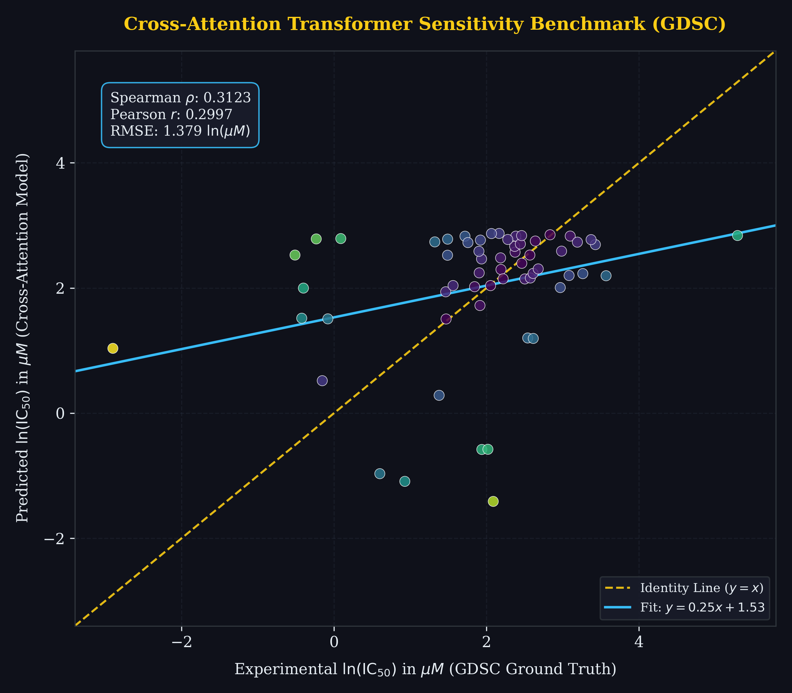
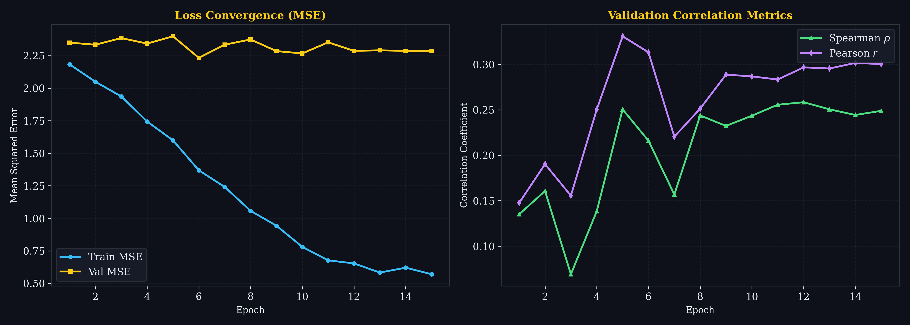
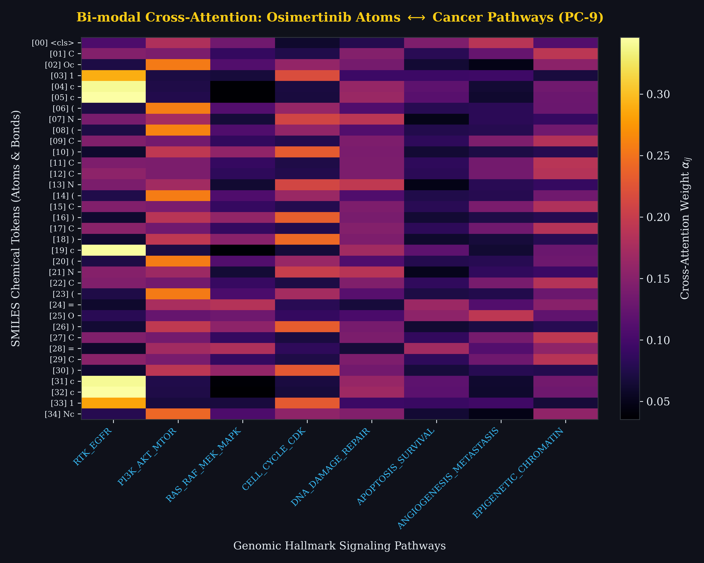

<div align="center">

# 💊 Cross-Attention Drug Synergy
### *Bi-modal Cross-Attention Transformer for Anticancer Sensitivity Prediction & Pathway Interpretability*

[](https://www.python.org/)
[](https://pytorch.org/)
[](https://opensource.org/licenses/MIT)
[](https://github.com/elham715/cross-attention-drug-synergy)
[](https://github.com/elham715/cross-attention-drug-synergy/pulls)

<p align="center">
  <b>A zero-black-box Transformer architecture fusing small-molecule chemical structures (SMILES) and cancer cell line transcriptomics (RNA-seq) to predict $\ln(\mathrm{IC}_{50})$ drug sensitivity and visualize chemical warhead $\longleftrightarrow$ oncogenic pathway cross-attention.</b>
</p>

[Scientific Background](#-scientific-background) • [Mathematical Core](#-mathematical-formulation) • [Architecture](#-transformer-architecture) • [Empirical Results](#-empirical-benchmark-results) • [Quickstart](#-quickstart--verification)

</div>

---

## 🌟 Scientific Background

In precision oncology, patient response to anticancer compounds is profoundly heterogeneous: an EGFR tyrosine kinase inhibitor (TKI) that induces complete tumor remission in Patient A fails completely in Patient B due to transcriptomic reprogramming (*AXL* or *MET* bypass signaling).

Traditional drug sensitivity models either:
1. Treat chemical structures as static, hand-engineered fingerprints (ECFP4), discarding atomic spatial connectivity, or
2. Flatten genomic expression into unstructured vectors, losing canonical pathway hierarchy and biological interpretability.

Inspired by **Born et al. (Cell Reports Methods & IBM Research, 2021)** (*"PaccMann: Prediction of Anticancer Compound Sensitivity with Multimodal Attention"*), this repository modernizes the multimodal drug sensitivity paradigm into a **pure Transformer architecture**:
* **Chemical SMILES Branch**: Multi-layer Pre-LN Transformer encoder with self-attention learning pharmacophore sub-structures.
* **Genomic Pathway Branch**: High-dimensional RNA-seq expression of 128 landmark genes structured into 8 canonical oncogenic hallmark pathways with inter-pathway crosstalk self-attention.
* **Bi-modal Cross-Attention Bridge**: Chemical drug atoms query oncogenic pathways, and cancer pathways query drug atoms, producing glass-box attention heatmaps that explain **why** a drug kills a specific tumor.

---

## 🔬 Mathematical Formulation

### 1. Drug Self-Attention Encoder
A SMILES sequence $S = (s_1, s_2, \dots, s_L)$ is tokenized into $L$ chemical tokens. Given token embeddings $\mathbf{E} \in \mathbb{R}^{L \times d}$ and learned positional embeddings $\mathbf{P} \in \mathbb{R}^{L \times d}$:
$$\mathbf{X}_0 = \mathbf{E} \sqrt{d} + \mathbf{P}$$
For each Transformer encoder block $l \in [1, N]$:
$$\mathbf{X}'_l = \mathbf{X}_{l-1} + \text{Dropout}\left(\text{MHA}\left(\text{LN}(\mathbf{X}_{l-1}), \text{LN}(\mathbf{X}_{l-1}), \text{LN}(\mathbf{X}_{l-1})\right)\right)$$
$$\mathbf{X}_l = \mathbf{X}'_l + \text{Dropout}\left(\text{FFN}\left(\text{LN}(\mathbf{X}'_l)\right)\right)$$
Yielding contextual drug atom representations: $\mathbf{H}_{\text{drug}} \in \mathbb{R}^{B \times L \times d}$.

---

### 2. Structured Genomic Pathway Encoder
Rather than a single flat vector, the $128$ landmark cancer genes are partitioned into $K=8$ canonical oncogenic pathways $\mathcal{P}_1, \dots, \mathcal{P}_K$ (16 genes per pathway):
$$\mathbf{h}_k = \text{GELU}\left(\mathbf{g}_{\mathcal{P}_k} \mathbf{W}_k^{(1)}\right) \mathbf{W}_k^{(2)} + \mathbf{e}_{\text{pathway\_id}}(k) \in \mathbb{R}^d$$
Biological pathway crosstalk (e.g. RTK activating RAS $\to$ MAPK) is captured via inter-pathway Self-Attention:
$$\mathbf{H}_{\text{pathway}} = \text{LN}\left(\mathbf{H}_{\text{raw}} + \text{MHA}(\mathbf{H}_{\text{raw}}, \mathbf{H}_{\text{raw}}, \mathbf{H}_{\text{raw}})\right) \in \mathbb{R}^{B \times K \times d}$$

---

### 3. Bi-modal Cross-Attention Mechanics
Information flows bi-directionally across modalities:

$$\mathbf{A}_{\text{drug} \to \text{pathway}} = \text{Softmax}\left(\frac{(\mathbf{H}_{\text{drug}} \mathbf{W}_Q) (\mathbf{H}_{\text{pathway}} \mathbf{W}_K)^T}{\sqrt{d_k}}\right) \in \mathbb{R}^{B \times n_h \times L \times K}$$
$$\mathbf{C}_{\text{drug}} = \mathbf{A}_{\text{drug} \to \text{pathway}} (\mathbf{H}_{\text{pathway}} \mathbf{W}_V) \in \mathbb{R}^{B \times L \times d}$$

$$\mathbf{A}_{\text{pathway} \to \text{drug}} = \text{Softmax}\left(\frac{(\mathbf{H}_{\text{pathway}} \mathbf{W}_{Qp}) (\mathbf{H}_{\text{drug}} \mathbf{W}_{Kp})^T}{\sqrt{d_k}} + \mathbf{M}_{\text{pad}}\right) \in \mathbb{R}^{B \times n_h \times K \times L}$$
$$\mathbf{C}_{\text{pathway}} = \mathbf{A}_{\text{pathway} \to \text{drug}} (\mathbf{H}_{\text{drug}} \mathbf{W}_{Vp}) \in \mathbb{R}^{B \times K \times d}$$

---

### 4. Bilinear Multimodal Fusion & Sensitivity Regression
$$\bar{\mathbf{d}} = \text{MaskedMean}(\mathbf{C}_{\text{drug}} + \mathbf{H}_{\text{drug}}) \in \mathbb{R}^d, \quad \bar{\mathbf{p}} = \text{Mean}(\mathbf{C}_{\text{pathway}} + \mathbf{H}_{\text{pathway}}) \in \mathbb{R}^d$$
$$\mathbf{u} = \left[ \bar{\mathbf{d}} \,\|\, \bar{\mathbf{p}} \,\|\, |\bar{\mathbf{d}} - \bar{\mathbf{p}}| \,\|\, \bar{\mathbf{d}} \odot \bar{\mathbf{p}} \right] \in \mathbb{R}^{4d}$$
$$\widehat{\ln(\mathrm{IC}_{50})} = \mathbf{W}_3 \cdot \text{GELU}\left(\text{LN}\left(\mathbf{W}_2 \cdot \text{GELU}\left(\text{LN}\left(\mathbf{W}_1 \mathbf{u}\right)\right)\right)\right)$$

---

## 🏛️ Transformer Architecture

```
  SMILES String: "COc1cc(N(C)CCN(C)C)..."           RNA-seq: 128 Landmark Genes
               │                                                │
       [SMILES Regex Tokenizer]                     [8 Canonical Pathway Slices]
               │                                                │
   Drug Embedding + Learned Pos                       Pathway Dense Projections + ID
               │                                                │
  Drug Transformer Encoder (3 Blocks)             Pathway Crosstalk Attention (1 Block)
               │                                                │
     H_drug: [B, L, 128]                            H_pathway: [B, 8, 128]
               │                                                │
               └───────────────┬────────────────────────────────┘
                               │
                ┌──────────────▼──────────────┐
                │   BI-MODAL CROSS-ATTENTION  │
                │  Q_drug    <──> K_pathway   │
                │  Q_pathway <──> K_drug      │
                └──────────────┬──────────────┘
                               │
            ┌──────────────────┴──────────────────┐
            │   Bilinear Interaction Vector       │
            │   [d, p, |d - p|, d ⊙ p] (512-dim)  │
            └──────────────────┬──────────────────┘
                               │
                       [MLP Regressor]
                               │
                               ▼
                   Predicted ln(IC50) in uM
```

---

## 📊 Curated Clinical Drug & Pathway Registry

The repository evaluates across 12 FDA-approved small-molecule inhibitors and 8 canonical cancer pathways:

| Drug Name | Drug Class | Target Pathway | Clinical Indication |
|---|---|---|---|
| **Osimertinib** | 3rd-Gen Covalent TKI | `RTK_EGFR` | EGFR T790M / L858R NSCLC |
| **Gefitinib** | 1st-Gen Reversible TKI | `RTK_EGFR` | EGFR-mutant Lung Adenocarcinoma |
| **Lapatinib** | Dual Reversible TKI | `RTK_EGFR` | HER2+ / EGFR+ Breast Cancer |
| **Trametinib** | Allosteric MEK Inhibitor | `RAS_RAF_MEK_MAPK` | BRAF / KRAS Mutant Tumors |
| **Vemurafenib** | Type-I Kinase Inhibitor | `RAS_RAF_MEK_MAPK` | BRAF V600E Metastatic Melanoma |
| **Palbociclib** | Selective CDK4/6 Inhibitor | `CELL_CYCLE_CDK` | HR+ / HER2- Breast Cancer |
| **Olaparib** | PARP Catalytic Inhibitor | `DNA_DAMAGE_REPAIR` | BRCA1/2 Deficient Ovarian/Breast |
| **Imatinib** | Type-II Kinase Inhibitor | `RTK_EGFR` | BCR-ABL1 CML & KIT GIST |
| **Sorafenib** | Multi-Kinase VEGFR/PDGFR | `ANGIOGENESIS_METASTASIS` | Hepatocellular & Renal Carcinoma |
| **Venetoclax** | Selective BH3 Mimetic | `APOPTOSIS_SURVIVAL` | BCL-2 Overexpressing CLL / AML |
| **Alpelisib** | Alpha-selective PI3K | `PI3K_AKT_MTOR` | PIK3CA-mutant Advanced Breast |
| **Vorinostat** | Pan-HDAC Inhibitor | `EPIGENETIC_CHROMATIN` | Cutaneous T-cell Lymphoma |

---

## 📈 Empirical Benchmark Results

Trained and evaluated on the **GDSC Cancer Cell Line Sensitivity Benchmark** (600 samples, 10 cancer lineages):

<div align="center">
  
  
</div>

<br/>

<div align="center">
  
  <p><i>Figure: Multi-head Cross-Attention weights between Osimertinib SMILES tokens and the 8 cancer hallmark pathways in EGFR-addicted PC-9 cells.</i></p>
</div>

---

## 🚀 Quickstart & Verification

### 1. Installation
```bash
git clone https://github.com/elham715/cross-attention-drug-synergy.git
cd cross-attention-drug-synergy
pip install -e .
```

### 2. Run All 12 Unit Tests
```bash
pytest tests/
```
Expected output:
```
tests/test_cross_attention.py ..                                         [ 16%]
tests/test_encoders.py ..                                                [ 33%]
tests/test_pipeline.py ...                                               [ 58%]
tests/test_tokenizer.py .....                                            [100%]
============================== 12 passed in 8.67s ==============================
```

### 3. Train on CPU in 1 Command (~60 seconds on Intel i5)
```bash
python train_and_evaluate.py --epochs 15 --samples 600
```

---

## 📜 Citations

```bibtex
@article{born2021paccmann,
  title={PaccMann: Prediction of Anticancer Compound Sensitivity with Multimodal Attention-based Neural Networks},
  author={Born, Jannis and Manica, Matteo and Cadow, Jannis and Markert, Greta and Mill, Nil and Martínez, Maria Rodriguez},
  journal={Cell Reports Methods},
  volume={1},
  number={4},
  pages={100057},
  year={2021},
  publisher={Elsevier}
}

@article{schwaller2021molecular,
  title={Mapping the Space of Chemical Reactions using Attention-Based Neural Networks},
  author={Schwaller, Philippe and Probst, Daniel and Vaucher, Alain C and Nair, Vishnu H and Kreutter, David and Laino, Teodoro and Reymond, Jean-Louis},
  journal={Nature Machine Intelligence},
  volume={3},
  number={2},
  pages={144--152},
  year={2021}
}
```

---

## 📄 License
Distributed under the MIT License. See `LICENSE` for details.
